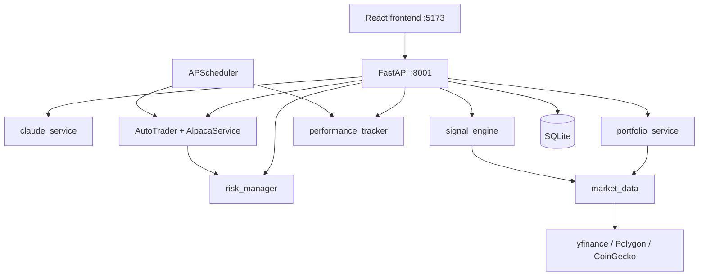

# RapidFire AI

Educational trading coach (**RapidFire AI**) that explains markets, generates technical signals, paper-trades autonomously, and can optionally graduate to a small live portfolio only after objective performance gates pass.

> **Not financial advice.** All coaching is educational. Live trading is OFF by default and gated.

## Status

**Stages 1–6 complete.** Stage 7 (live mode wiring polish) and Stage 8 (enhancements) remain. Live stays disabled until env + readiness + typed confirmation.

## Stack

| Layer | Tech |
|-------|------|
| Backend | Python 3.11+, FastAPI, SQLAlchemy 2, SQLite, Pydantic v2, APScheduler |
| Frontend | React + Vite + TypeScript + TailwindCSS + Recharts |
| Data | yfinance (default), Polygon.io (optional), CoinGecko (crypto) |
| Broker | Alpaca paper first; live behind gates |
| AI | Anthropic Claude via `claude_service.py` (`CLAUDE_MODEL`) |

## Quick start

```bash
cp .env.example .env
# set ANTHROPIC_API_KEY (and optional Alpaca / Polygon keys)

# Backend
cd backend
python3.12 -m venv .venv   # 3.11+ required
source .venv/bin/activate
pip install -r requirements.txt
uvicorn main:app --reload --host 127.0.0.1 --port 8001
# → http://127.0.0.1:8001/docs

# Frontend (separate terminal)
cd frontend
npm install
npm run dev
# → http://127.0.0.1:5173  (proxies /api → :8001)
```

## Architecture



## Environment

| Variable | Default | Notes |
|----------|---------|-------|
| `ANTHROPIC_API_KEY` | empty | Required for coach / verdicts |
| `CLAUDE_MODEL` | `claude-sonnet-5-5` | Used only via `claude_service.py` |
| `AUTO_TRADER_DRY_RUN` | `true` | Log decisions; no broker orders |
| `LIVE_TRADING_ENABLED` | `false` | Env alone is never enough |
| `ALPACA_PAPER` | `true` | Paper API venue |
| `DATABASE_URL` | `sqlite:///./rapidfire.db` | Local SQLite |

## AutoTrader dry-run

Default ON. Watch `AutoTradeLog` (`would_trade` / `skip`) for a full day before setting `AUTO_TRADER_DRY_RUN=false`.

Scheduler: scan every **15 min**, crypto monitor every **5 min**, daily snapshot **16:05 ET**.

## Order-path rule

Every order requires `RiskManager.check_trade_allowed()` → `AlpacaService.place_market_order(..., risk=...)`. No bypass flags.

## Go-readiness (Stage 6)

All must pass: 30+ days data, 40+ closed trades, win rate ≥ 52%, profit factor ≥ 1.3, Sharpe ≥ 1.0, max drawdown ≤ 12%, no single day worse than −4%.

**Note:** 40 trades is a sanity minimum, not proof of an edge. Keep live size small regardless.

## Known limitations

- **Alpaca crypto:** no bracket orders — stops/targets enforced in the 5-minute monitor job.
- **IPO calendar:** needs `POLYGON_API_KEY`; otherwise empty with an explanatory error.
- **Movers:** liquid-universe scan via yfinance, not a full tape.
- **Live mode:** still requires Stage-7 discipline; Phase-1 caps live in `risk_manager` ($500 / 3 positions / whitelist).
- Coach needs a valid `ANTHROPIC_API_KEY`; without it endpoints return graceful error text.

## Stage checklist

1. ✅ Foundations
2. ✅ Signal engine + risk manager + tests + dry-run + security gates
3. ✅ Claude coaching layer (SSE ask)
4. ✅ Paper portfolio + React frontend
5. ✅ Autonomous paper trader (scheduler, brackets, monitor, thesis review)
6. ✅ Performance tracking + go-readiness + dashboard
7. ⬜ Optional live mode polish (disabled by default)
8. ⬜ Enhancements (regime, alerts, options viewer, WebSockets)
